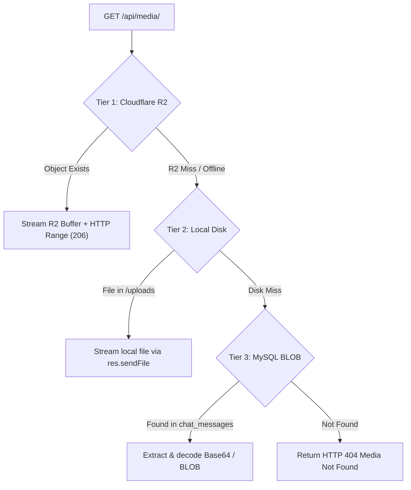

# SGB CRM — Complete Technical Memory & System Architecture Specification (MEMORY.md)

> **Document Version:** 1.0.0  
> **System Name:** SGB Agro Industries Enterprise CRM & Omni-Channel Automation Platform  
> **Target Environment:** Node.js (v18+ / v22+), Express.js, MySQL 8.x / MariaDB, Cloudflare R2 Storage, Meta WhatsApp Cloud API v21.0, Acefone Telephony, Firebase Cloud Messaging (FCM).  
> **Purpose:** Single source of truth recording every minor and major technical architecture, data model, business logic pipeline, database schema, frontend component, and operational guideline across the entire codebase.

---

## Table of Contents
1. [Executive System Overview](#1-executive-system-overview)
2. [Global Technology Stack & Dependencies](#2-global-technology-stack--dependencies)
3. [Core System Infrastructure & Server Lifecycle](#3-core-system-infrastructure--server-lifecycle)
4. [Storage Engine & 3-Tier Media Architecture (Cloudflare R2)](#4-storage-engine--3-tier-media-architecture-cloudflare-r2)
5. [Complete Database Schema & Field-Level Dictionary](#5-complete-database-schema--field-level-dictionary)
6. [Backend API Directory & Route Controllers](#6-backend-api-directory--route-controllers)
7. [Frontend Architecture & Shared Component Engine](#7-frontend-architecture--shared-component-engine)
8. [Module-by-Module Technical Breakdown](#8-module-by-module-technical-breakdown)
   - 8.1 [Customer Support & Field Job Cards Module](#81-customer-support--field-job-cards-module)
   - 8.2 [B2B Dealer Network & Analytics Module](#82-b2b-dealer-network--analytics-module)
   - 8.3 [Sales Command Center & Lead Telecaller Pipeline](#83-sales-command-center--lead-telecaller-pipeline)
   - 8.4 [Omnichannel WhatsApp Inbox & Automated Chatbot Engine](#84-omnichannel-whatsapp-inbox--automated-chatbot-engine)
   - 8.5 [Acefone Cloud Telephony & WebRTC Dialer](#85-acefone-cloud-telephony--webrtc-dialer)
   - 8.6 [Billing, Invoicing & Payment Proof Verification](#86-billing-invoicing--payment-proof-verification)
   - 8.7 [Logistics, Packing & Shipping Dispatch](#87-logistics-packing--shipping-dispatch)
   - 8.8 [Admin Control Tower, RBAC & System Telemetry](#88-admin-control-tower-rbac--system-telemetry)
9. [Role-Based Access Control (RBAC) & Permission Matrix](#9-role-based-access-control-rbac--permission-matrix)
10. [Configuration, Environment Variables & Port Management](#10-configuration-environment-variables--port-management)
11. [Historical Modifications & Recent Changelog](#11-historical-modifications--recent-changelog)

---

## 1. Executive System Overview

The **SGB Agro Industries CRM** is a centralized, high-concurrency enterprise resource planning and customer relationship management platform designed specifically for agricultural machinery manufacturing, direct-to-consumer (B2C) sales, business-to-business (B2B) dealer distribution, automated customer support, and after-sales service tracking.

### Core Ecosystem Pillars:
1. **Direct B2C Telecaller Sales Engine**: Ingests leads from digital ad campaigns (Meta, Google, IndiaMART, Website), validates phone numbers, runs automated round-robin or manual assignment to sales executives, and tracks calls, follow-ups, and order conversion.
2. **B2B Dealer Network**: Manages registered agricultural equipment dealers across India, monitors 45-day credit validity timelines, processes bulk distributor orders, tracks sales rep field visits with GPS coordinates, and provides deep product sales analytics with multi-selection filters.
3. **Automated WhatsApp Conversational Engine**: Integrates with Meta WhatsApp Business Cloud API (v21.0) with an automated visual Flow Engine (`FlowEngine.js`), smart intent detection, interactive catalog buttons, media broadcasts, automated receipt parsing, and live agent chat handoff.
4. **Cloud Telephony (Acefone Integration)**: Native browser click-to-call WebRTC dialer, real-time call logging, automated call recording storage, agent CDR metrics, and webhook-driven incoming/outgoing call popups.
5. **Post-Delivery Customer Support & Field Job Cards**: Automatically syncs delivered B2C orders, queues initial unboxing and installation calls, schedules 30-day product health check follow-ups, generates physical service/repair Job Cards with spare parts, labour charges, before/after inspection media, and touchscreen customer signatures.
6. **Billing, Packing & Logistics Pipeline**: Generates GST-compliant tax invoices, coordinates warehouse picking and packing with barcode checks, manages shipping dispatch with AWB generation, and verifies customer payment transfer screenshots.

---

## 2. Global Technology Stack & Dependencies

### Backend Runtime & Framework:
- **Node.js**: v18.x / v22.x LTS runtimes.
- **Express.js (v4.22.1)**: Core HTTP application server.
- **mysql2 (v3.24.6)**: Asynchronous connection pooling with automatic keep-alive, query retry, and statement preparation.
- **Cloud Storage**: `@aws-sdk/client-s3` (v3.1140.0), `@aws-sdk/lib-storage`, `@aws-sdk/s3-request-presigner` connecting to Cloudflare R2 object storage.
- **Security & Headers**: `helmet` (v8.1.0), `cors` (v2.8.5), `compression` (v1.8.2), `express-rate-limit` (v8.5.2).
- **Authentication**: `jsonwebtoken` (v9.0.2) with Bearer token authentication, `bcryptjs` (v2.4.3) with 10 salt rounds.
- **Document & Spreadsheet Generation**: `pdfkit` (v0.20.2) for invoice and Job Card rendering, `exceljs` (v4.4.0) for high-performance multi-column XLSX/CSV data exports.
- **HTTP Clients**: `axios` (v1.21.0) for Meta WhatsApp Graph API, Acefone, and Zoho Books communications.
- **File Uploads**: `multer` (v2.5.0) handling multipart form-data.
- **Notifications**: `firebase-admin` (v14.2.0) powering Firebase Cloud Messaging (FCM) web push notifications.

### Frontend Client Architecture:
- **Vanilla ES6+ JavaScript**: Zero heavy framework dependencies; modular vanilla JS architecture ensuring maximum execution speed, zero compile-step overhead, and lightweight memory footprints.
- **HTML5 & CSS3**: Custom design system featuring glassmorphic elevation cards, full-width responsive grids, and standard top navigation.
- **Iconography & Fonts**: FontAwesome Pro/Free 6.5.1, Google Fonts (`Inter` & `Outfit`).
- **Data Visualization**: `Chart.js` for analytics graphs, line charts, doughnut conversion charts, and sales velocity tracking.

---

## 3. Core System Infrastructure & Server Lifecycle

### 3.1 Server Startup & Process Guardian (`backend/server.js`)
The application server (`server.js`) features self-healing port collision resolution:
- Default Listening Port: `5000` (or `process.env.PORT`).
- **Automatic Port Conflict Resolution**: If `EADDRINUSE` is detected upon startup, `server.js` triggers a Windows command:
  ```powershell
  netstat -ano | findstr :5000
  taskkill /PID <pid> /F
  ```
  It terminates orphaned Node or development processes holding the port and automatically retries binding after 1000ms.
- **Background Cron Schedulers**:
  - **Customer Support 30-Day Follow-Up Checker**: Runs upon boot and every `60 * 60 * 1000` ms (1 hour) via `customerSupportService.processDueFollowups()`. Identifies cases reaching 30 days post-installation and flags follow-ups as `DUE`.
  - **Payment Verification Polling**: Client-side component polling runs every 6 seconds to update verification badges.

### 3.2 Express Middleware Stack (`backend/src/app.js`)
1. **Proxy Trust**: `app.set('trust proxy', 1)` ensuring correct client IP resolution behind reverse proxies (Nginx / Cloudflare).
2. **Helmet Security**: Disables restrictive Content Security Policy (`contentSecurityPolicy: false`) to allow external FontAwesome, Google Fonts, and Cloudflare R2 assets while maintaining strict origin policies (`crossOriginResourcePolicy: 'cross-origin'`).
3. **Payload Limits**: JSON and URL-encoded limits set to `150mb` to accommodate high-resolution product inspection images, video clips, and multipart attachments.
4. **Developer Telemetry Cockpit (`monitor.middleware.js`)**: Real-time zero-overhead in-memory telemetry recording API request duration, memory usage, CPU load, error spikes, and active sockets accessible at `/monitor`.
5. **Database Leakage Sanitizer**: Intercepts `res.json` responses and automatically strips raw SQL queries, syntax errors, table names, and stack traces, replacing them with generic `"Internal database server error"` messages to prevent reconnaissance attacks.
6. **Rate Limiter**: Caps general API endpoints at 10,000 requests per 15-minute window per IP.

---

## 4. Storage Engine & 3-Tier Media Architecture (Cloudflare R2)

### 4.1 Cloudflare R2 Integration (`backend/src/services/storage.service.js`)
The platform uses Cloudflare R2 as its primary object storage repository (S3-compatible API with zero egress fees):
- **Default Bucket**: `sgb-crm-media`
- **Customer Support Media Folder**: `customer_support/`
- **Accepted File Formats**: Images (`.jpg`, `.jpeg`, `.png`, `.webp`, `.gif`, `.heic`) and Videos (`.mp4`, `.mov`, `.webm`, `.avi`, `.mkv`, `.3gp`).
- **File Size Cap**: Configured up to `60 MB` per file for field service videos and installation walkthroughs.

### 4.2 3-Tier Streaming Fallback Pipeline (`GET /api/media/*`)
When an asset is requested via `/api/media/<objectKey>`:

- **HTTP Range Request Support**: Essential for seamless scrubbing, fast-forwarding, and seeking inside video attachments on both desktop and mobile browsers.

---

## 5. Complete Database Schema & Field-Level Dictionary

The platform uses MySQL (InnoDB engine, `utf8mb4_unicode_ci` collation). Below is the comprehensive schema documentation for the primary modules.

### 5.1 Authentication, RBAC & Users
- **`users`**:
  - `user_id` (INT, PK, AUTO_INCREMENT): Unique user identifier.
  - `name` (VARCHAR 150): Full operator/employee name.
  - `email` (VARCHAR 150, UNIQUE): Login email address.
  - `password` (VARCHAR 255): bcrypt hashed password string.
  - `role_id` (INT, FK -> `roles.role_id`): User authorization role.
  - `department_id` (INT, FK -> `departments.id`): Operational department (19 = Customer Support, Sales, Dealer Admin, etc.).
  - `phone` (VARCHAR 20): Mobile contact number.
  - `is_active` (TINYINT 1): 1 for active, 0 for deactivated.
  - `fcm_token` (TEXT): Web push notification token for Firebase.
  - `created_at`, `updated_at`: Timestamps.

- **`roles`**:
  - `role_id` (INT, PK, AUTO_INCREMENT).
  - `role_name` (VARCHAR 50, UNIQUE): e.g., `super-admin`, `admin`, `sales_manager`, `telecaller`, `dealer_admin`, `billing_officer`, `customer_support_executive`, `viewer`.
  - `description` (VARCHAR 255).

- **`departments`**:
  - `id` (INT, PK, AUTO_INCREMENT).
  - `name` (VARCHAR 100, UNIQUE): e.g., `Sales`, `Support`, `Billing`, `Warehouse`, `Dealer Management`.

### 5.2 Customer Support & Field Service Tables
- **`customer_support_cases`**:
  - `case_id` (INT, PK, AUTO_INCREMENT).
  - `case_number` (VARCHAR 50, UNIQUE): Formatted as `CS-YYYY-XXXXX`.
  - `order_id` (INT, NULL, UNIQUE): Associated B2C order (for delivered order sync).
  - `manual_order_number` (VARCHAR 100, NULL): Custom or external order reference.
  - `lead_id` (INT, NULL): Associated lead record.
  - `customer_name` (VARCHAR 150, NOT NULL).
  - `customer_phone` (VARCHAR 50, NOT NULL, INDEX).
  - `product_summary` (TEXT): Aggregated list of machinery and implements purchased.
  - `assigned_to` (INT, FK -> `users.user_id`): Assigned customer support executive.
  - `status` (ENUM): `'delivered'`, `'pending_contact'`, `'contacted'`, `'guidance_in_progress'`, `'completed'`, `'cancelled'`.
  - `delivery_date` (DATETIME).
  - `initial_call_date` (DATETIME).
  - `installation_status` (VARCHAR 50): e.g., `successfully_installed`, `in_progress`, `needs_more_guidance`, `technician_required`.
  - `completed_at` (DATETIME): Timestamp when initial onboarding was marked completed.

- **`customer_support_calls`**:
  - `call_id` (INT, PK, AUTO_INCREMENT).
  - `case_id` (INT, FK -> `customer_support_cases.case_id`).
  - `call_type` (ENUM): `'INITIAL'`, `'FOLLOW_UP'`.
  - `call_outcome` (ENUM): `'answered'`, `'not_answered'`, `'switched_off'`, `'not_reachable'`, `'busy'`, `'callback_required'`, `'no_assistance_needed'`.
  - `installation_status` (ENUM): `'successfully_installed'`, `'in_progress'`, `'needs_more_guidance'`, `'technician_required'`, `'not_applicable'`.
  - `guidance_provided` (TEXT): Detailed telephonic advice given to the customer.
  - `installation_instructions` (TEXT).
  - `product_usage_guidance` (TEXT).
  - `customer_questions` (TEXT).
  - `reported_problems` (TEXT).
  - `feedback` (TEXT).
  - `remarks` (TEXT).
  - `created_by` (INT, FK -> `users.user_id`).
  - `created_at` (TIMESTAMP).

- **`customer_support_photos`**:
  - `photo_id` (INT, PK, AUTO_INCREMENT).
  - `case_id` (INT, FK -> `customer_support_cases.case_id`).
  - `call_id` (INT, NULL).
  - `file_url` (VARCHAR 500): Cloudflare R2 media path (`/api/media/customer_support/...`).
  - `file_name` (VARCHAR 255).
  - `file_size` (INT): Bytes.
  - `uploaded_by` (INT, FK -> `users.user_id`).
  - `created_at` (TIMESTAMP).

- **`customer_support_notes`**:
  - `note_id` (INT, PK, AUTO_INCREMENT).
  - `case_id` (INT, FK -> `customer_support_cases.case_id`).
  - `call_id` (INT, NULL).
  - `note` (TEXT): Freeform agent commentary, historical observations, or WhatsApp transcript logs.
  - `created_by` (INT, FK -> `users.user_id`).
  - `created_at` (TIMESTAMP).

- **`customer_support_followups`**:
  - `followup_id` (INT, PK, AUTO_INCREMENT).
  - `case_id` (INT, FK -> `customer_support_cases.case_id`).
  - `order_id` (INT, NULL).
  - `customer_name` (VARCHAR 150).
  - `customer_phone` (VARCHAR 50).
  - `assigned_to` (INT, FK -> `users.user_id`).
  - `followup_type` (VARCHAR 50): Default `'30_DAY_PRODUCT_CHECK'`, or `'CALLBACK'`.
  - `scheduled_date` (DATE, INDEX).
  - `status` (ENUM): `'UPCOMING'`, `'DUE'`, `'OVERDUE'`, `'COMPLETED'`.
  - `product_condition` (ENUM): `'working_fine'`, `'minor_issue'`, `'major_issue'`, `'not_using'`.
  - `any_issues` (ENUM): `'yes'`, `'no'`.
  - `customer_feedback` (TEXT).
  - `issue_description` (TEXT).
  - `next_action` (ENUM): `'no_action_required'`, `'followup_again'`, `'technician_required'`, `'service_required'`, `'replacement_required'`.
  - `remarks` (TEXT).
  - `notification_sent` (TINYINT 1).
  - `completed_at` (DATETIME).

- **`customer_support_job_cards`**:
  - `job_card_id` (INT, PK, AUTO_INCREMENT).
  - `job_card_number` (VARCHAR 50, UNIQUE): e.g., `JC-YYYYMMDD-XXXX`.
  - `case_id` (INT, NULL, FK -> `customer_support_cases.case_id`).
  - `order_id` (INT, NULL).
  - `customer_name` (VARCHAR 150).
  - `customer_phone` (VARCHAR 50).
  - `customer_address` (TEXT).
  - `product_summary` (TEXT).
  - `job_card_date` (DATE).
  - `technician_name` (VARCHAR 150).
  - `machine_make_model` (VARCHAR 255).
  - `serial_vin_number` (VARCHAR 150).
  - `hours_run` (VARCHAR 50).
  - `job_type` (ENUM): `'Installation'`, `'Service/Repair'`, `'Inspection'`, `'Replacement Assessment'`, `'Other'`.
  - `priority` (ENUM): `'Low'`, `'Medium'`, `'High'`, `'Urgent'`.
  - `status` (ENUM): `'Draft'`, `'Open'`, `'In Progress'`, `'On Hold'`, `'Completed'`, `'Cancelled'`.
  - `specific_complaint` (VARCHAR 255).
  - `original_issue_description` (TEXT).
  - `initial_diagnosis` (TEXT).
  - `before_work_condition` (VARCHAR 255).
  - `work_performed` (TEXT).
  - `final_machine_condition` (VARCHAR 255).
  - `parts_total` (DECIMAL 12,2).
  - `labour_total` (DECIMAL 12,2).
  - `discount_amount` (DECIMAL 12,2).
  - `taxable_amount` (DECIMAL 12,2).
  - `tax_percent` (DECIMAL 5,2).
  - `tax_amount` (DECIMAL 12,2).
  - `shipping_charge` (DECIMAL 12,2).
  - `grand_total` (DECIMAL 12,2).
  - `amount_paid` (DECIMAL 12,2).
  - `balance_amount` (DECIMAL 12,2).
  - `payment_status` (ENUM): `'Paid'`, `'Partially Paid'`, `'Unpaid'`.
  - `payment_mode` (VARCHAR 50).
  - `assigned_to` (INT, FK -> `users.user_id`).
  - `due_date` (DATE).
  - `work_completion_date` (DATETIME).
  - `customer_feedback` (TEXT).
  - `technician_remarks` (TEXT).
  - `customer_signature` (LONGTEXT): Base64 PNG signature string from HTML canvas.
  - `signature_date` (DATETIME).
  - `cancellation_reason` (TEXT).
  - `created_by` (INT, FK -> `users.user_id`).
  - `completed_by` (INT, FK -> `users.user_id`).
  - `completed_by_name` (VARCHAR 150).

- **`customer_support_job_card_parts`**:
  - `part_id` (INT, PK, AUTO_INCREMENT).
  - `job_card_id` (INT, FK -> `customer_support_job_cards.job_card_id`).
  - `part_name` (VARCHAR 255).
  - `part_number` (VARCHAR 100).
  - `quantity` (DECIMAL 10,2).
  - `unit_cost` (DECIMAL 10,2).
  - `total_cost` (DECIMAL 10,2).
  - `is_foc` (TINYINT 1): Free of Charge warranty replacement indicator.
  - `remarks` (VARCHAR 255).

- **`customer_support_job_card_labour`**:
  - `labour_id` (INT, PK, AUTO_INCREMENT).
  - `job_card_id` (INT, FK -> `customer_support_job_cards.job_card_id`).
  - `labour_description` (VARCHAR 255).
  - `hours` (DECIMAL 10,2).
  - `rate` (DECIMAL 10,2).
  - `total_cost` (DECIMAL 12,2).
  - `remarks` (VARCHAR 255).

- **`customer_support_job_card_photos`**:
  - `photo_id` (INT, PK, AUTO_INCREMENT).
  - `job_card_id` (INT, FK -> `customer_support_job_cards.job_card_id`).
  - `photo_type` (ENUM): `'BEFORE_WORK'`, `'AFTER_WORK'`, `'issue'`, `'before'`, `'after'`, `'other'`.
  - `file_url` (VARCHAR 500).
  - `file_name` (VARCHAR 255).
  - `file_size` (INT).
  - `caption` (VARCHAR 255).
  - `uploaded_by` (INT).

- **`customer_support_job_card_logs`**:
  - `log_id` (INT, PK, AUTO_INCREMENT).
  - `job_card_id` (INT, FK -> `customer_support_job_cards.job_card_id`).
  - `action` (VARCHAR 100): e.g., `'CREATED'`, `'STATUS_UPDATE'`, `'PARTS_UPDATED'`, `'COMPLETED'`, `'CANCELLED'`.
  - `previous_status` (VARCHAR 50).
  - `new_status` (VARCHAR 50).
  - `notes` (TEXT).
  - `performed_by` (INT).
  - `created_at` (TIMESTAMP).

### 5.3 B2B Dealer Network & Audit Log Tables
- **`dealers`**:
  - `dealer_id` (INT, PK, AUTO_INCREMENT).
  - `shop_name` (VARCHAR 150, NOT NULL).
  - `owner_name` (VARCHAR 100).
  - `phone` (VARCHAR 20, UNIQUE, NOT NULL).
  - `email` (VARCHAR 100).
  - `gst_number` (VARCHAR 20).
  - `address`, `city`, `district`, `state`, `pincode`.
  - `vrl_code`, `nearest_vrl_location`: Transport / courier delivery routing.
  - `assigned_salesperson_id` (INT, FK -> `users.user_id`).
  - `status` (ENUM): `'active'`, `'inactive'`, `'blocked'`.
  - `last_order_date` (DATETIME): Crucial for calculating the 45-day active validity window.
  - `credit_limit` (DECIMAL 12,2).
  - `outstanding_amount` (DECIMAL 12,2).

- **`dealer_activity_logs`**:
  - `log_id` (INT, PK, AUTO_INCREMENT).
  - `user_id` (INT, NULL).
  - `user_name` (VARCHAR 150).
  - `user_role` (VARCHAR 100).
  - `module` (VARCHAR 100): Default `'DEALER'`.
  - `action` (VARCHAR 150): e.g., `'CREATE'`, `'UPDATE'`, `'DELETE_ORDER'`, `'EXPORT_EXCEL'`, `'LOGIN'`.
  - `entity_type` (VARCHAR 60): e.g., `'DEALER'`, `'DEALER_ORDER'`, `'DEALER_VISIT'`.
  - `entity_id` (VARCHAR 64).
  - `details` (TEXT): Human-readable activity narrative.
  - `ip_address` (VARCHAR 64): Cleaned IPv4 address.
  - `user_agent` (TEXT): Full client agent string.
  - `device_summary` (VARCHAR 150): Parsed `OS · Browser` summary (e.g., `Windows · Chrome`).
  - `metadata` (TEXT / JSON): JSON payload containing previous vs updated state diffs.
  - `created_at` (TIMESTAMP).

---

## 6. Backend API Directory & Route Controllers

The backend routing structure is organized under `backend/src/routes/` and handled by corresponding controllers in `backend/src/controllers/`:

| Route Prefix | Controller | Functional Scope |
| :--- | :--- | :--- |
| `/api/auth` | `auth.controller.js` | User login, JWT token issuance, session verification, user profile update, password reset. |
| `/api/customer-support` | `customer_support.controller.js` | Delivered order sync, case queue management, call logging, photo uploads to R2, 30-day health checks, full Job Card lifecycle (Draft/Open/Complete/Cancel), A4 print rendering, technician roster. |
| `/api/dealers` | `dealer.controller.js` | Dealer CRUD, 45-day validity tracking, visits GPS check-in, dealer reports, multi-product filtering, ExcelJS exports, activity logs (`GET /activity-logs`). |
| `/api/orders` | `order.controller.js` | B2C/B2B order processing, status progression (`ordered` -> `packed` -> `shipped` -> `delivered`), line items calculation, transport details. |
| `/api/leads` | `lead.controller.js` | Inbound lead ingestion, assignment algorithms, telecaller disposition logs, conversion to orders, lead status history. |
| `/api/whatsapp` | `whatsapp.controller.js` | Two-way messaging, media upload/streaming, reaction tracking, template messages, human handoff triggers, unread message clearance. |
| `/webhook` | `webhook.routes.js` | Meta Cloud API webhook receiver (delivers message statuses, incoming media, interactive replies, button clicks). |
| `/api/chatbot` | `chatbot.controller.js` | Visual flow builder configurations, trigger nodes, intent keywords, interactive message components. |
| `/api/telephony` | `telephony.controller.js` | Acefone click-to-call bridge, extension management, encrypted token storage, call detail records (CDR) ingestion. |
| `/api/billing` | `billing.controller.js` | GST tax invoices, invoice PDF generation, Zoho Books contact and invoice synchronization, payment verification queue. |
| `/api/logistics` | `logistics.controller.js` | Packing slip generation, warehouse dispatch manifests, courier AWB tracking. |
| `/api/inventory` | `inventory.controller.js` | Warehouse SKU tracking, stock adjustments, low-stock threshold alerts. |
| `/api/monitoring` | `monitor.controller.js` | Live CPU, memory, event-loop lag, error rates, and API telemetry feeds. |

---

## 7. Frontend Architecture & Shared Component Engine

### 7.1 Unified Layout Architecture
Every module in SGB CRM adheres to a strict two-column dashboard layout:
```html
<div class="dashboard-wrapper"> <!-- or .support-wrapper -->
    <!-- Dynamic Sidebar (Loaded via components.js) -->
    <div id="sidebar-container"></div>

    <!-- Main Content Container -->
    <main class="main-content"> <!-- or .support-main -->
        <!-- Standard Sticky CRM Topbar -->
        <header class="topbar">
            <div class="hamburger" onclick="window.toggleMobileSidebar()">
                <i class="fas fa-bars"></i>
            </div>
            <div class="search-bar">
                <i class="fa-solid fa-magnifying-glass"></i>
                <input type="text" id="topNavSearch" placeholder="Search...">
            </div>
            <div class="profile-section">
                <!-- Injected: #topbarDialerBtn (Phone button) on eligible panels -->
                <!-- Injected: .notif-bell (Notification bell with #notifBadge) -->
                <span class="profile-name" id="profileName">Operator Name</span>
                <div class="avatar"><span id="avatarInitial">O</span></div>
            </div>
        </header>

        <!-- Module Content Body -->
        <div class="content-body"> <!-- or .support-content -->
            <!-- Page Title, Action Buttons, KPI Cards, Filters, Data Tables -->
        </div>
    </main>
</div>
```

### 7.2 Shared Component Engine (`frontend/js/components.js`)
`components.js` is the central UI orchestrator loaded on every page:
1. **Dynamic Sidebar Injection (`renderSidebar`)**:
   - Inspects the user's role and page path.
   - Automatically selects and fetches `sidebar-admin.html`, `sidebar-sales.html`, `sidebar-dealer.html`, or `sidebar-support.html`.
   - Injects the active nav link class based on `window.location.pathname`.
2. **Topbar Hydration**:
   - Queries `#profileName` and displays `user.name`.
   - Generates the avatar circle containing the capital initial of the user's first name.
   - Binds the `.profile-section` click event to navigate to [`modules/admin/profile.html`](file:///d:/sgb%20scratch%20v__1.1..2/frontend/modules/admin/profile.html).
   - Injects `.notif-bell` dynamically with an unread badge counter (`#notifBadge`).
3. **WebRTC Phone Dialer Injection (`injectGlobalDialer`)**:
   - Dynamically prepends `#topbarDialerBtn` (`📞`) into `.profile-section` on sales, dealer, admin, and billing modules.
   - Automatically **excludes** customer support to keep the header clean as requested.
4. **Payment Verification Topbar Badge (`updatePaymentTopBarBadge`)**:
   - Polls pending WhatsApp payment transfer screenshots every 6 seconds.
   - Renders the `#btn-top-payment` pill in topbars.
   - Automatically **excludes** customer support and billing modules to prevent duplicate or irrelevant alerts.

---

## 8. Module-by-Module Technical Breakdown

### 8.1 Customer Support & Field Job Cards Module
- **Directory**: `frontend/modules/customer_support/`
- **Pages**:
  1. `dashboard.html`: Executive overview with 6 KPI cards (New Orders Delivered, Pending Installation, Contacted / Follow Up, 30-Day Follow-ups Due, Overdue Follow-ups, Completed Cases) and Active Support Queue.
  2. `orders_delivered.html`: Queue of freshly delivered B2C orders requiring initial customer outreach.
  3. `contacted_followup.html`: Two-tab management view for Installation In-Progress / Callbacks and 30-Day Product Health Checks.
  4. `completed.html`: Historical archive of resolved cases with full call and photo evidence audit trails.
  5. `job_cards.html`: Technical field service & repair directory with status filtering (All, Draft, Open, In Progress, On Hold, Completed, Cancelled).
  6. `job_card_details.html`: Full workspace for creating, editing, diagnosing, pricing spare parts/labour, taking customer canvas signatures, and printing clean A4 service sheets.
  7. `customer_details.html`: 360-degree customer profile view displaying order items, call timeline, notes, and photos.
  8. `call_completion.html`: Structured call disposition logger capturing guidance provided, installation status, defects, and photo uploads.
  9. `followup_details.html`: Dedicated 30-day health check interface evaluating crop yield, machinery condition, and satisfaction ratings.
  10. `settings.html`: Configuration for auto-assignment, 30-day follow-up rules, and technician rosters.
- **Media Upload Pipeline**: Uploads directly to Cloudflare R2 bucket `sgb-crm-media/customer_support/` with support for files up to 60MB.

### 8.2 B2B Dealer Network & Analytics Module
- **Directory**: `frontend/modules/dealer/`
- **Key Capabilities**:
  1. **45-Day Validity Lifecycle**: Identifies active dealers whose `last_order_date` exceeds 45 days. Categorizes validity into `0-15 Days` (Active), `16-30 Days` (Warning), `31-45 Days` (Critical), and `>45 Days` (Inactive).
  2. **Multi-Product Filter (`product_multiselect.js`)**: A custom-engineered dropdown supporting multiple simultaneous product selections with checkboxes, search filtering, tag pills, select-all, and URL state synchronization.
  3. **Order Export Engine**: Uses `exceljs` on the server to dynamically generate XLSX/CSV reports splitting complex multi-product order payloads into discrete item and subtotal columns.
  4. **Activity Log & Audit Trail (`activity_log.html`)**: Real-time admin monitoring of database mutations, logins, order cancellations, and dealer record updates, logging client IPv4, device specifications, and user agents.

### 8.3 Sales Command Center & Lead Telecaller Pipeline
- **Directory**: `frontend/modules/sales/`
- **Key Capabilities**:
  - Live revenue monitoring, telecaller call productivity graphs, and pipeline stage velocity (New Lead -> Contacted -> Demo Scheduled -> Quotation -> Closed Won / Lost).
  - Telecaller round-robin lead distribution with automated daily call quotas.
  - Lead disposition recording with immediate Acefone telephony call triggers.

### 8.4 Omnichannel WhatsApp Inbox & Automated Chatbot Engine
- **Directory**: `frontend/modules/whatsapp/` & `frontend/modules/chatbot/`
- **Key Capabilities**:
  - WhatsApp Business Cloud API v21.0 integration.
  - Multi-agent shared inbox supporting simultaneous operator conversations with typing indicators, read receipts, and message reactions.
  - Visual Node-Based Flow Engine (`FlowEngine.js`): Executes logic graphs, delivers interactive button menus, matches keyword intents, and manages fallback timeouts.
  - Human Handover: Automatically pauses the chatbot and reassigns the conversation to a human telecaller when complex inquiries or payment proofs are submitted.

### 8.5 Acefone Cloud Telephony & WebRTC Dialer
- **Directory**: `frontend/modules/acefone/`
- **Key Capabilities**:
  - Embedded softphone dialer modal draggable anywhere on screen.
  - AES-256 encrypted credential storage (`telephony_crypto.service.js`).
  - Webhook listener processing incoming CDR events, agent disposition codes, and call recording audio URLs.

### 8.6 Billing, Invoicing & Payment Proof Verification
- **Directory**: `frontend/modules/billing/`
- **Key Capabilities**:
  - GST-compliant invoice generation with state-specific CGST/SGST/IGST breakdown.
  - Automated PDF invoice rendering using `pdfkit`.
  - Payment proof lightbox modal: Inspects customer bank transfer receipts sent over WhatsApp and enables one-click approval or rejection.

### 8.7 Logistics, Packing & Shipping Dispatch
- **Directory**: `frontend/modules/shipping/` & `frontend/modules/packing/`
- **Key Capabilities**:
  - Warehouse packaging checklist preventing missing implements or attachments.
  - Transport partner routing (VRL Logistics, Delhivery, etc.) with automated tracking updates.
  - Marking an order as `delivered` triggers an automated webhook event creating a new record in `customer_support_cases`.

---

## 9. Role-Based Access Control (RBAC) & Permission Matrix

The system implements strict permission checks across frontend navigation and backend API endpoints:

| Role Name | Access Scope | Customer Support | Dealer Module | Sales Module | Billing Module | Admin Settings |
| :--- | :--- | :---: | :---: | :---: | :---: | :---: |
| **`super-admin`** | Unrestricted system-wide control | Full | Full | Full | Full | Full |
| **`admin`** | Complete operational management | Full | Full (incl. Activity Log) | Full | Full | Full |
| **`sales_manager`**| Sales team management & leads | View Only | View Only | Full | View Only | None |
| **`telecaller`** | Assigned leads & calls | None | None | Assigned Only | None | None |
| **`dealer_admin`** | Dealer network & B2B orders | None | Full (excl. Activity Log) | None | View Only | None |
| **`billing_officer`**| Invoices, payments & receipts | None | Orders View | None | Full | None |
| **`customer_support`**| Post-delivery cases & Job Cards | Full | None | None | None | None |
| **`viewer`** | Read-only audit mode | Read-Only | Read-Only | Read-Only | Read-Only | None |

---

## 10. Configuration, Environment Variables & Port Management

### Required `.env` Keys:
```env
# Application & Server
PORT=5000
NODE_ENV=production
APP_BASE_URL=http://localhost:5000
JWT_SECRET=your_jwt_super_secret_key

# MySQL Database (Hostinger / Cloud DB)
DB_HOST=127.0.0.1
DB_PORT=3306
DB_USER=root
DB_PASSWORD=your_db_password
DB_NAME=sgb_crm_db
DB_CONNECTION_LIMIT=10

# Cloudflare R2 Object Storage
R2_ACCOUNT_ID=your_cloudflare_account_id
R2_ACCESS_KEY_ID=your_r2_access_key_id
R2_SECRET_ACCESS_KEY=your_r2_secret_access_key
R2_BUCKET=sgb-crm-media
R2_ENDPOINT=https://<account_id>.r2.cloudflarestorage.com
R2_REGION=auto

# Meta WhatsApp Cloud API (v21.0)
WHATSAPP_TOKEN=your_meta_system_user_token
PHONE_NUMBER_ID=your_meta_phone_number_id
WHATSAPP_BUSINESS_ACCOUNT_ID=your_waba_id
WEBHOOK_VERIFY_TOKEN=your_custom_webhook_verify_token

# Acefone Telephony
ACEFONE_API_BASE_URL=https://api.acefone.in/v1

# Firebase Cloud Messaging
FIREBASE_SERVICE_ACCOUNT_PATH=./firebase-service-account.json
```

---

## 11. Historical Modifications & Recent Changelog

1. **Dealer Module Multi-Product Filter**:
   - Replaced single-product dropdown with custom multi-select checkbox menu (`frontend/modules/dealer/js/product_multiselect.js`).
   - Updated backend SQL queries in `dealer.controller.js` to parse comma-separated product lists and filter using dynamic `LIKE` or `IN` conditions.
2. **Dealer Activity Log & Audit Trail**:
   - Created `dealer_activity_logs` table and logging helper `backend/src/utils/dealerActivityLogger.js`.
   - Instrumented logging on dealer creation, modification, order deletion, and export actions.
   - Built `frontend/modules/dealer/activity_log.html` matching modern enterprise audit trails; restricted access strictly to administrators.
3. **Customer Support UI Standardization**:
   - Unified all 10 Customer Support HTML pages with the standard CRM topbar layout (`<header class="topbar">`).
   - Embedded `.search-bar`, operator `#profileName`, `.avatar` initial circle, and `.notif-bell`.
   - Cleanly removed redundant or misplaced inline profile elements, call dialer icons, and payment verification buttons from Customer Support pages.
4. **Targeted Database Cleanup Transaction**:
   - Safely purged specified historical test Job Cards (`JC-20261103-0001`, `JC-20261023-0001`) and Cases (`CS-2026-00074` through `CS-2026-04710`).
   - Ensured atomic ACID execution with pre-deletion JSON backups, removing zero shared customer or order records.
5. **WhatsApp Favorites Filter & Telecaller Scoping Fix**:
   - Created MySQL table `whatsapp_user_favorites (id, user_id, phone, created_at)`.
   - Added API routes `GET /api/whatsapp/favorites` and `POST /api/whatsapp/favorites/toggle`.
   - Updated `backend/src/services/message.service.js`: Added `is_favorite` flag to `mapCustomerRow`, `favoriteCount` metrics, and dedicated `favorites` tab filter.
   - Fixed Telecaller chat loading bug where telecaller scoping used a subquery with `LIMIT 3000`, causing chat lists to truncate to 10-12 records instead of loading the user's full assignees.
   - Enhanced WhatsApp UI (`frontend/modules/whatsapp/`): Gold star button on customer cards, `#active-chat-favorite-btn` in chat header, "Favorites" sidebar filter pill, and right-click context menu toggle.
6. **Customer Support - Removed "Installation Instructions Explained" Field**:
   - Removed input field and label from Section 3 of `frontend/modules/customer_support/call_completion.html`, re-aligning the layout into a clean, balanced 2x2 grid.
   - Updated `call_completion.js` with optional chaining to prevent null reference errors on submission.
7. **Customer Support - Media Auto-Compression & Removal of File Size Labels**:
   - Hidden all file size indicators (`(Max 60MB each)`, `up to 60MB`, etc.) across `call_completion.html`, `job_card_details.html`, and client validations.
   - Raised upload ceiling to 550MB in `backend/src/routes/customer_support.routes.js` and `frontend/modules/customer_support/js/support-common.js`.
   - Implemented client-side Canvas auto-compression in `support-common.js` to downscale high-resolution photos to ~1–2MB before transmission.
   - Implemented automated FFmpeg video transcoding in `backend/src/controllers/customer_support.controller.js`: Videos uploaded up to 500MB+ exceeding 55MB are dynamically compressed (720p H.264, bitrate calculated via `ffprobe` duration) to strictly under 60MB before being permanently uploaded to Cloudflare R2 and cleaned from disk.

---
*End of Technical Memory Specification (MEMORY.md)*

